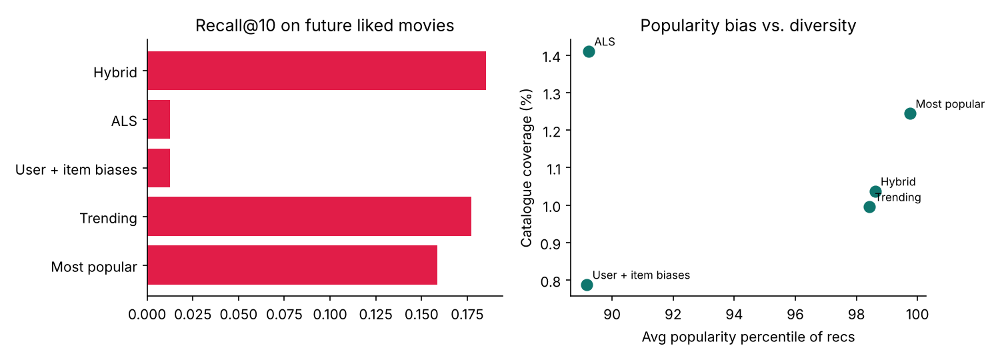

# Movie Recommender: Collaborative Filtering with Honest Evaluation

A from-scratch **matrix-factorisation recommender (ALS in NumPy)** evaluated the way a real product would be: on users' *future* ratings, with ranking metrics and a popularity-bias check. The headline finding is that the model with the best rating accuracy is not the best recommender, and a simple hybrid wins.

  

**Data:** [MovieTweetings](https://github.com/sidooms/MovieTweetings) (100K snapshot), real 0–10 movie ratings people posted on Twitter. After a 5-core filter: **68,055 ratings, 4,333 users, 2,410 movies**.

## Method

1. **Temporal split**: each user's latest 20% of ratings form the test set, so we predict the future rather than random holes in the past.
2. **Models**, from simple to complex:
   - Global mean, then regularised **user + item biases** (closed-form alternating updates)
   - **Biased matrix factorisation** with Alternating Least Squares (k = 16), written in NumPy with no recommender library
   - Most-popular and **trending** (last 30 days) baselines
   - **Hybrid** = z(ALS score) + α · z(trending), with α tuned on a validation split carved from the training data only
3. **Metrics**: RMSE for rating accuracy; **precision/recall@10** on movies the user later rated ≥ 8; **catalogue coverage** and **average popularity percentile** of recommendations to expose popularity bias.

## Results (held-out future ratings)

| Model | RMSE ↓ | Precision@10 ↑ | Recall@10 ↑ | Coverage | Avg. popularity pct |
|---|---|---|---|---|---|
| Global mean | 1.776 | – | – | – | – |
| Most popular (all time) | – | 0.027 | 0.159 | 1.2% | 99.755 |
| Trending (last 30 days) | – | 0.032 | 0.177 | 1.0% | 98.420 |
| User + item biases | 1.419 | 0.003 | 0.013 | 0.8% | 89.173 |
| Matrix factorisation (ALS) | 1.416 | 0.003 | 0.013 | 1.4% | 89.234 |
| Hybrid: ALS + trending (α=4.0) | – | 0.033 | 0.185 | 1.0% | 98.611 |



## What I learned

- **Low RMSE ≠ good recommendations.** Biases and ALS cut RMSE from 1.78 to about 1.42, but as top-10 recommenders they barely find anything (recall 0.013). Predicting *how much* you'd like a movie is a different task from predicting *what you'll watch next*.
- **Recency dominates this dataset.** MovieTweetings users mostly tweet about films that just came out, so "trending in the last 30 days" is a strong baseline (recall 0.177).
- **The hybrid beats every baseline** (recall@10 **0.185**) by re-ranking trending movies with personal taste from ALS.
- **The trade-off is popularity bias.** Popularity-driven models recommend from about 1% of the catalogue. ALS alone reaches more of it but with poor accuracy. A production system would add diversity constraints or exploration on top.

## Project structure

```
src/recsys/data.py      download, iterative k-core filter, per-user temporal split
src/recsys/models.py    GlobalMean, Biases, BiasedALS (+ fold-in for new users)
src/recsys/evaluate.py  RMSE, precision/recall@k, coverage, popularity percentile
src/recsys/train.py     tuning, evaluation, figures, model export
app.py                  Streamlit demo: rate a few movies → recommendations
tests/                  unit tests (k-core, split, metrics, ALS recovers a low-rank signal)
```

## Run it

```bash
pip install -r requirements.txt
python -m src.recsys.train     # ~5 seconds
streamlit run app.py
pytest
```
